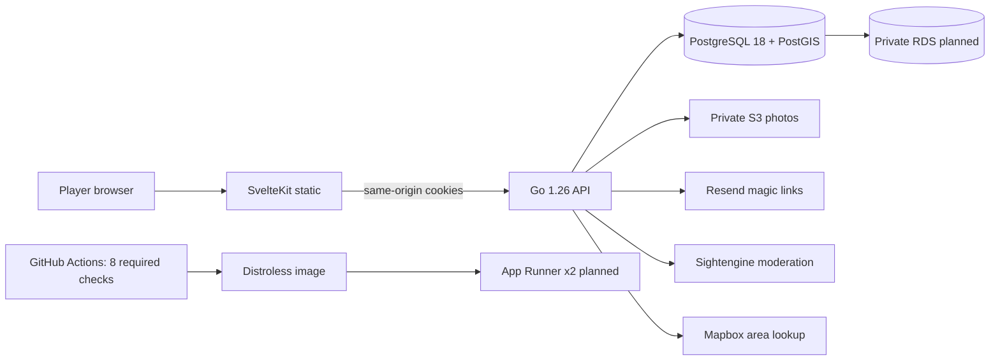
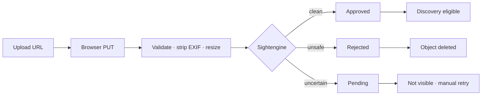
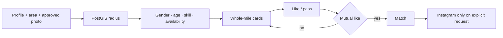
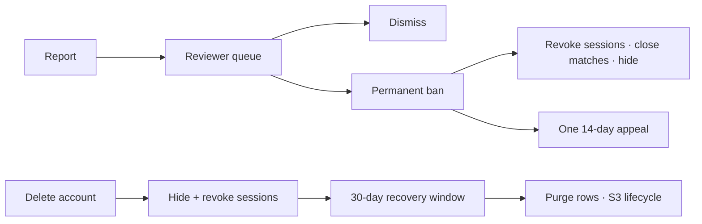

# Tennis Connect

Adult-only UK tennis matchmaking. Safety-first Go API, PostGIS discovery, private photos, static SvelteKit client.

## Stack

## Core flows

### Photo gate

### Discovery to match

### Safety and account

## Technical decisions

| Decision | Reason |
| --- | --- |
| Go stdlib `net/http`, pgx v5 | Small surface, explicit routing and SQL |
| PostgreSQL/PostGIS source of truth | Radius, travel and filters run server-side |
| Whole-mile distance buckets | Prevents coordinate triangulation |
| Presigned S3 uploads and reads | API never receives or serves raw image bytes |
| Synchronous, fail-closed moderation | Provider failure never auto-approves |
| Static SvelteKit served by Go | Same-origin cookies, no CORS layer |
| Separate reviewer identity + TOTP | No shared admin account; MFA on every review |
| Rebase-only PRs, 8 required checks | Linear history, CI as the merge gate |

## Security invariants

- E-mail, date of birth, exact coordinates and photo object keys never leave the server.
- Instagram is disclosed only inside a live match, on explicit request.
- Contact details in names, bios and photo OCR fail closed.
- Banned accounts lose sessions, matches and discovery visibility; same e-mail cannot re-register.
- Export is owner-scoped and excludes other players' private data.
- Private responses are `no-store`; cookies are `HttpOnly`, `SameSite`, `Secure` outside local HTTP.

## Status

| Area | State |
| --- | --- |
| Backend Tasks 1–7 | Shipped: auth, profiles, photos, location, discovery, matches, safety/account |
| Frontend | Shipped: onboarding, discovery, matches, profile, safety, account, reviewer console |
| Deployable image | Shipped: multi-stage distroless, non-root, container smoke test |
| Production load and dense-city capacity | Unproven on production-like hardware |
| iOS Safari / Android Chrome | Manual pass still open |
| PITR, RPO/RTO drills | Still open |
| CD | Deferred; `main` deploys nothing |

## Docs

- [API reference](docs/api.md)
- [Local development](docs/local-development.md)
- [Security model](docs/security.md)
- [Deployment](docs/deploy.md)
- [Pentest scope](docs/pentest-scope.md)
- [UX specification](docs/design/v1-ux-spec.md)
- [CI and branch protection](docs/ci.md)
